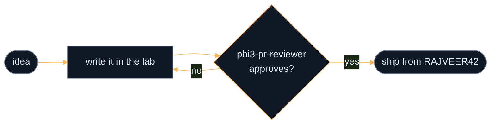

<!--
  VIDEO: GitHub only plays video that it hosts. Drag an .mp4 into this file in the
  web editor, wait for the github.com/user-attachments/... link to appear, and keep
  that link on its own line. Put it under "work" if you want a demo reel.
-->

<div align="center">


<br/>

[](#work)
[](#now)
[](#stack)
[](#activity)
[](#contact)

</div>

<br/>

I fine-tune small language models, build backend systems, and send patches upstream to open source projects.
This is the lab account, where experiments live. The polished versions ship from [RAJVEER42](https://github.com/RAJVEER42).


## work

| project | what it does |
|:--|:--|
| [phi3-pr-reviewer](https://github.com/Valyrian-Code/phi3-pr-reviewer) | A fine-tuned phi-3 that reviews pull requests. It once flagged a bug I had merged two weeks earlier. |
| [generative-ai-essentials](https://github.com/Valyrian-Code/RAJVEER42-Generative-AI-Essentials-) | The full fine-tuning workflow, documented so the next person skips my mistakes. |
| [notes.](https://github.com/Valyrian-Code/notes.) | Everything I learn, written down in one place. |
| fossology, nrnb, lfevents | Upstream contributions to open source projects. The fossology patch was accepted. |


## now

<div align="center">

</div>


## stack

<div align="center">

</div>

<br/>




## activity

<div align="center">

<!-- The snake appears after you run the workflow once (see .github/workflows/snake.yml).
     Until then this points at a demo so nothing renders broken. After the first run, swap BOTH urls to:
       https://raw.githubusercontent.com/Valyrian-Code/Valyrian-Code/output/github-contribution-grid-snake-dark.svg
       https://raw.githubusercontent.com/Valyrian-Code/Valyrian-Code/output/github-contribution-grid-snake.svg -->
<picture>
  <source media="(prefers-color-scheme: dark)" srcset="https://raw.githubusercontent.com/Platane/snk/output/github-contribution-grid-snake-dark.svg"/>
  <source media="(prefers-color-scheme: light)" srcset="https://raw.githubusercontent.com/Platane/snk/output/github-contribution-grid-snake.svg"/>
  
</picture>


</div>

<br/>

<details>
<summary><b>lab log</b></summary>
<br/>

```diff
+ adapter merged. loss went down and stayed down
+ pr bot deployed. it immediately requested changes on my own code
! vram at 97%
- colab free tier killed the session at epoch 3 of 4
+ fossology patch accepted upstream
```

</details>

<details>
<summary><b>why valyrian</b></summary>
<br/>

Valyrian steel is folded and reforged until nothing weak remains. A training loop is the same idea: run it, test it, throw out what fails, run it again.

If `phi3-pr-reviewer` ever approves its own pull request, I will stop and look at what I built.

</details>


## contact

<div align="center">

[](https://github.com/RAJVEER42)
[](https://www.linkedin.com/in/rajveer-bishnoi-576b62356)
[](mailto:irajveer.bishnoi2310@email.com)

<sub>Open to open source collaboration, ML experiments, and arguments about fine-tuning versus RAG. Open an issue and I will answer it faster than a text.</sub>

</div>
