<div align="center">


<sub>the lab · alt account of <a href="https://github.com/RAJVEER42">RAJVEER42</a> · 35 repos · bengaluru, not albuquerque</sub>

<br/><br/>

<a href="https://github.com/RAJVEER42"></a>&nbsp;
<a href="https://www.linkedin.com/in/rajveer-bishnoi-576b62356"></a>&nbsp;
<a href="mailto:irajveer.bishnoi2310@email.com"></a>&nbsp;


</div>

<br/>

let me be clear about how this works.

the main account, [RAJVEER42](https://github.com/RAJVEER42), is the car wash. clean, presentable, recruiters walk through and everything smells like lemon. this account is what's underneath. the lab. this is where the actual cooking happens, and what comes out of here is, and i say this with full humility, remarkably pure.

i am not in danger of shipping a bug. i am the one who ships. and then reverts. and then ships again, correctly.

---

### the cook (currently)

```console
$ cat batch-log.txt

BATCH #42       phi-3-mini, QLoRA'd on github PR reviews
PURITY          99.1% (the 0.9% is print statements i forgot to remove)
METHOD          low heat, 4 epochs, constant supervision
DISTRIBUTION    the car wash gets whatever survives
SIDE EFFECTS    the bot now reviews my code. it is not gentle.
```

---

### the product

<sub>we make code here. technically it's all legal. that's the twist.</sub>

| batch | street name | what it does | purity |
|:---|:---|:---|:---:|
| 🧪 [phi3-pr-reviewer](https://github.com/Valyrian-Code/phi3-pr-reviewer) | *"the critic"* | fine-tuned phi-3 that reviews PRs while i sleep. once flagged a bug i'd merged two weeks earlier. i felt seen and prosecuted. | 99.1% |
| 📓 [notes.](https://github.com/Valyrian-Code/notes.) | *"the ledger"* | where everything gets written down. gale had a notebook too, and look, i'm choosing not to finish that comparison. | 91% |
| ⚡ [generative-ai-essentials](https://github.com/Valyrian-Code/RAJVEER42-Generative-AI-Essentials-) | *"the recipe"* | the full cook, documented. everything i wish someone told me before epoch one. | 96% |
| 🔬 fossology · nrnb · lfevents forks | *"the distribution network"* | patches delivered to open source territories. no turf wars. maintainers were lovely. | pure rep |

<details>
<summary>&nbsp;📼 <b>surveillance tape</b> (recovered from the lab)</summary>
<br/>

```diff
+ [ok]    adapter merged. loss curve went down and stayed down. yeah science!
+ [ok]    pr bot deployed to production. immediately requested changes on my code
! [warn]  vram at 97%. this is a high-pressure cook. respect the process
- [fail]  colab free tier killed the session at epoch 3 of 4. i want a lawyer
+ [ok]    fossology patch accepted upstream. the network grows
+ [ok]    notes. updated 03:12. the lab never closes, it just dims
```

</details>

---

### lab equipment

| apparatus | condition |
|:---|:---|
| python | primary instrument. calibrated daily |
| pytorch, transformers, peft | the good glassware. handled with both hands |
| java, spring boot | industrial grade. boring. never explodes. that's the point |
| react, next.js | the storefront fixtures. customers only see these |
| docker, k8s | containment vessels. mostly contain |
| aws | the money goes in, the compute comes out, nobody asks questions |
| css | volatile. two of us have been hurt |
| regex | schedule I substance. write-only. do not attempt to read back |

<div align="center">


</div>

---

### the operation

```mermaid
%%{init: {'theme':'base','themeVariables':{'primaryColor':'#0B2B26','primaryTextColor':'#D7FFE0','primaryBorderColor':'#F5C518','lineColor':'#0A6E4F','fontFamily':'monospace'}}}%%
graph LR
  A(["an idea<br/>(usually 3am)"]) --> B["🧪 THE LAB<br/>this account"]
  B --> C{"purity<br/>check"}
  C -->|"≥ 99%"| D["🚗 THE CAR WASH<br/>RAJVEER42"]
  C -->|"< 99%"| E["🏜 THE DESERT<br/>archived. we don't dig it up."]
  D --> F(["shipped.<br/>have an A1 day!"])
  E -.->|"lessons.<br/>allegedly."| B

  style A fill:#0B2B26,stroke:#5CD1E5
  style B fill:#0A6E4F,stroke:#F5C518,stroke-width:2px
  style C fill:#0B2B26,stroke:#F5C518
  style D fill:#0A6E4F,stroke:#5CD1E5,stroke-width:2px
  style E fill:#3d2b1f,stroke:#8B8680
  style F fill:#0B2B26,stroke:#F5C518
```



---

### the books

<sub>the numbers the IRS can see. the real accounting is in the commit history.</sub>

<div align="center">

<table>
<tr>
<td align="center">

</td>
<td align="center">

</td>
</tr>
</table>


</div>

---

### the desert snake

<sub>it patrols the contribution grid. it has seen where everything is buried.</sub>

<div align="center">

<!-- demo snake shown so nothing renders broken.
     after running the workflow below once, swap BOTH urls to:
       https://raw.githubusercontent.com/Valyrian-Code/Valyrian-Code/output/github-contribution-grid-snake-dark.svg  (dark)
       https://raw.githubusercontent.com/Valyrian-Code/Valyrian-Code/output/github-contribution-grid-snake.svg       (light) -->
<picture>
  <source media="(prefers-color-scheme: dark)" srcset="https://raw.githubusercontent.com/Platane/snk/output/github-contribution-grid-snake-dark.svg"/>
  <source media="(prefers-color-scheme: light)" srcset="https://raw.githubusercontent.com/Platane/snk/output/github-contribution-grid-snake.svg"/>
  
</picture>

</div>

<details>
<summary>&nbsp;🐍 <b>snake setup</b> (one-time, then it runs itself)</summary>
<br/>

drop this at `.github/workflows/snake.yml` in the `Valyrian-Code/Valyrian-Code` repo, commit, run once from the <kbd>Actions</kbd> tab.

```yaml
name: snake
on:
  schedule:
    - cron: "0 */12 * * *"
  workflow_dispatch:
  push:
    branches: [main]
permissions:
  contents: write
jobs:
  generate:
    runs-on: ubuntu-latest
    steps:
      - uses: Platane/snk@v3
        with:
          github_user_name: Valyrian-Code
          outputs: |
            dist/github-contribution-grid-snake.svg
            dist/github-contribution-grid-snake-dark.svg?palette=github-dark&color_snake=#F5C518
      - uses: crazy-max/ghaction-github-pages@v4
        with:
          target_branch: output
          build_dir: dist
        env:
          GITHUB_TOKEN: ${{ secrets.GITHUB_TOKEN }}
```

</details>

---

### lab safety protocol

```console
rule 1   no half measures. either write the test or delete the feature
rule 2   never force-push to main. we've all seen what happens to people who get greedy
rule 3   every batch gets documented, even the ones we bury in the desert
rule 4   if the build is green on the first try, assume a trap
rule 5   the lab makes the product. the car wash takes the credit. that's the arrangement
```

> 🎩 *"you clearly don't know who you're talking to, so let me clue you in. i am not blocked by the segfault. i AM the segfault."*
> <sub>attributed. loosely.</sub>

---

### evidence locker

<details>
<summary>&nbsp;🗄 <b>SEALED. DO NOT OPEN UNTIL THE FINALE.</b></summary>
<br/>

```text
found taped under the desk, in careful handwriting:

  this account exists because the main one got too clean.
  every dev needs a place where a 4am idea can fail in private.

  the name on the door says valyrian. steel folded and reforged
  until nothing weak remains. same as a training loop.
  the show was just on in the background. these things layer.

  and if one day phi3-pr-reviewer approves its own pull request,
  walk away from the lab. don't look back.

  W.W.?  no. R.B.

  ...my star. my perfect silence. my 200 OK.
```

<kbd>↑</kbd> <kbd>↑</kbd> <kbd>↓</kbd> <kbd>↓</kbd> <kbd>←</kbd> <kbd>→</kbd> <kbd>←</kbd> <kbd>→</kbd> <kbd>B</kbd> <kbd>A</kbd> &nbsp; *you know the code. you've always known the code.*

</details>

---

<div align="center">

<sub>open channel for: OSS collabs · ML experiments · anyone who wants to argue fine-tuning vs RAG in a parking lot</sub>

**[irajveer.bishnoi2310@email.com](mailto:irajveer.bishnoi2310@email.com)** · or open an issue. i answer those faster than texts.

<br/>

<sub>⚗ we're done when i say we're done. (the CI says we're done.) ⚗</sub>

<sub>yeah, science!</sub>


</div>
